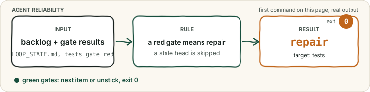

# loop-engine

**An agent on a long project keeps adding features while the tests are failing, because nothing outside the chat tells it to repair first.**

[](https://github.com/homayoun-safarpour/agent-loop-engine/actions/workflows/ci.yml)


Agent reliability: decide one next action for an agent loop from a markdown backlog and exit-code gates, and journal it.

loop-engine is a small command-line tool that reads a markdown backlog, runs the quality gates a team names, and prints one next action. We built it because an agent on a long project can keep adding features while its tests fail, and a rule written in a prompt to stop this cannot be unit-tested. Given the gate results, it applies fixed rules in order: a failing gate means repair, a backlog head untouched for more than two days is skipped in favour of the cheapest open item, and otherwise the next item is taken. It prints the action, target and reason, appends them to a journal, and exits 0.

```bash
git clone https://github.com/homayoun-safarpour/agent-loop-engine
cd agent-loop-engine && pip install -e .
loop-engine tick --state examples/LOOP_STATE.md --gate "tests=python examples/fail_gate.py"
```

```text
action : repair
target : tests
reason : gate 'tests' is red; no new work on a broken base
```

That command exits 0, because a decision was made, and it appends the decision to `journal/JOURNAL.md`. The gate `examples/fail_gate.py` always exits 1, so the red-gate path is the same on Windows and Unix.



[How it works](#how-it-works) · [Results](#what-each-result-means) · [Limits](#limits) · [Interview pack](docs/INTERVIEW.md) · [Cite](#citation) · Part of [a small open stack for checking AI agents and their judges](https://homayoun-safarpour.github.io)

## What each result means

| Action | Exit | Meaning |
|---|---|---|
| `repair` | 0 | A gate failed. The target is the first failed gate, and no backlog item is offered. |
| `unstick` | 0 | Gates passed, but the head item was touched more than `--stale-days` days ago (default 2). The target is the cheapest open item (S, then M, then L). |
| `advance` | 0 | Gates passed, and the head item is fresh, undated or already the cheapest. The target is the first open item. |
| `close` | 0 | The backlog has no open items. The target is `cycle`. |
| (error) | 2 | The state file is missing or has a checkbox line it cannot read (a bad date, an unknown cost, a tag given twice), or a `--gate` value is not `NAME=COMMAND` with a non-empty name. The message goes to stderr, and no decision or journal entry is written. |

A decision shows which kind of step the rules allow next. It does not show that the work done in that step was good, and because every decision exits 0, a tick does not fail a CI job by itself.

## Use this when

| Situation | Use loop-engine? |
| --- | --- |
| You want one next action after pytest, ruff or any other check with an exit code | Yes |
| You need a journal that a later session can read without the chat log | Yes |
| You want the tool to carry out the backlog item | No. It prints the order, and a person, a cron job or an agent carries it out |
| You want a CI job to fail when a check is red | No. Make the check itself the CI step, or use [trace-gate](https://github.com/homayoun-safarpour/trace-gate) for agent runs |
| You want a language model to choose the next task | No. The rules are fixed Python with unit tests |

The package is not on PyPI yet. `pip install git+https://github.com/homayoun-safarpour/agent-loop-engine` is the other way to install it.

## The problem

An agent working on a project session by session tends to make three mistakes. It adds new work while the tests are red, so every later change makes the repair larger. It waits on the hardest item at the head of the backlog, so nothing else moves. It keeps no memory between sessions, so decisions are made again from old chat logs. A scheduler runs tasks on time, but it does not decide which task is safe to run, and that decision is small enough to write as code and test.

## How it works

1. `loopengine.state` reads the loop's state file, a markdown file with one checkbox line per backlog item.
2. `loopengine.gates` runs each `--gate` command and records pass (exit 0) or fail.
3. `loopengine.decide` picks one action, in this order of priority: `repair`, `unstick`, `advance`, `close`.
4. `loopengine.journal` appends the gate results and the decision to the journal.

Backlog lines look like this. The bullet may be `-`, `*`, `+` or a number, and the `cost` and `touched` tags may come in either order. Other lines are ignored, so the file can also hold notes.

```markdown
- [x] M1 Baseline model training script with fixed seed (cost: M) (touched: 2026-08-01)
- [ ] M2 Add evaluation harness with held-out split (cost: L) (touched: 2026-08-01)
- [ ] M3 Wire ruff + pytest into pre-commit (cost: S) (touched: 2026-08-02)
```

With green gates on the bundled example, the head item M2 is stale, so the cheapest open item is taken:

```bash
loop-engine tick --state examples/LOOP_STATE.md \
  --gate "tests=python -m pytest -q" \
  --gate "lint=ruff check src tests"
```

```text
action : unstick
target : M3 Wire ruff + pytest into pre-commit
reason : head item stale 111d (> 2d); momentum beats order, taking the cheapest open item
```

The day count depends on the run date (20 November 2026 here). With `--json`, the first-screen command prints:

```text
{"action": "repair", "target": "tests", "reason": "gate 'tests' is red; no new work on a broken base"}
```

The journal entry for the green-gate tick (path set with `--journal`):

```markdown
## 2026-11-20 01:37
- gates: tests=PASS, lint=PASS
- decision: **unstick** -> M3 Wire ruff + pytest into pre-commit
- reason: head item stale 111d (> 2d); momentum beats order, taking the cheapest open item
```

Interview pack: [docs/INTERVIEW.md](docs/INTERVIEW.md). Claim limits: [docs/RELIABILITY_CARD.md](docs/RELIABILITY_CARD.md). Before automating a loop, the [field guide](docs/FIELD_GUIDE.md) and the blank contract in [`examples/loop_contract/`](examples/loop_contract/) list five decisions to make first.

## Limits

- It is not a task runner or an agent. It prints one order per tick and never runs the backlog item.
- It does not judge the work itself. A decision is only as good as its gates.
- Gate commands run through the shell exactly as written, with a 600-second timeout, and a timeout counts as a failure. On timeout the gate and every process it started are stopped. Gate output is read as UTF-8, and bytes that are not UTF-8 are replaced. Use only commands you trust.
- Staleness comes from the hand-written `touched` date. An undated item is never stale, and an item without a cost counts as M.
- It needs Python 3.10 or later and has no runtime dependencies.

## How we did it

1. **Wrote the policy as code.** The rules are plain Python in `loopengine/decide.py`, so each one has a unit test instead of a sentence in a prompt.
2. **Kept the state in markdown.** Anyone can edit the backlog in any editor, so the queue survives if the tool breaks.
3. **Made the journal append-only.** A later session reads why the project is in its current state. Named tests: `test_a_red_gate_always_beats_new_work`, `test_a_stale_head_yields_to_the_cheapest_item`, `test_readme_first_screen_matches_top100_craft`.

## Related tools

- [agent-loop-field-guide](https://github.com/homayoun-safarpour/agent-loop-field-guide): the Loop Contract to fill in before you automate.
- [trace-gate](https://github.com/homayoun-safarpour/trace-gate): fails CI when recorded agent runs score below a frozen baseline (exit 0 or 2).
- [judge-drift-sentinel](https://github.com/homayoun-safarpour/judge-drift-sentinel): tells a change in the system from a change in the judge.
- [judge-field-guide](https://github.com/homayoun-safarpour/judge-field-guide): a link-checked map of tools for language-model judges.

## Contributing

Run `pytest -q` and `ruff check src tests` before a pull request, as CI does on Python 3.10 to 3.12.

## Citation

```bibtex
@software{safarpour2026agentloopengine,
  author = {Homayoun Safarpour},
  title  = {agent-loop-engine: a self-advancing loop for AI agents},
  year   = {2026},
  url    = {https://github.com/homayoun-safarpour/agent-loop-engine}
}
```

Author: Homayoun Safarpour. [LinkedIn](https://www.linkedin.com/in/homayoun-safarpour/)

## License

MIT. See [`LICENSE`](LICENSE).
